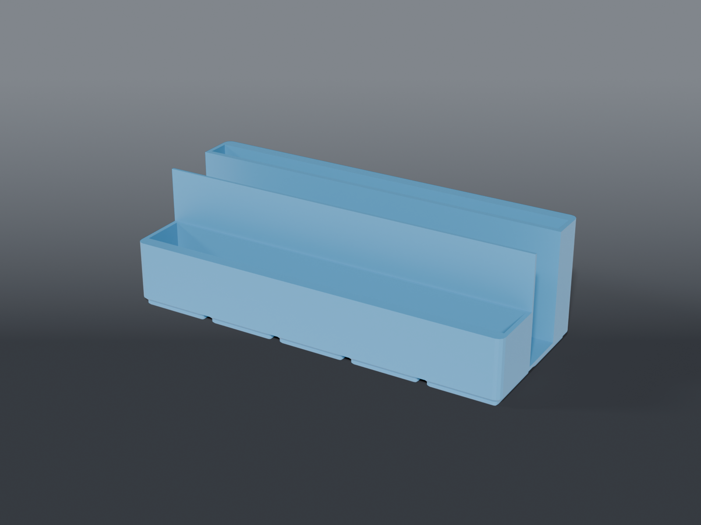

# Fixture rack

A **5×2 Gridfinity storage rack** that stands three repair fixtures on edge, like books, so they live on the bench without spreading across it. It's built from the user's own sketch: three slots side by side, stepped down at the front so a hand gets in.

## Parts

| Part | File | Size | Print |
|---|---|---|---|
| **Rack** | `fixture_rack.scad` | 209.5 × 83.5 mm; 67 mm tall at the back, 37 at the front | ×1 — feet down, no supports |
| Layout coupon | `coupons/layout_fit_coupon.scad` | the rack's outline at full length, 5 mm tall | print first, ~34 g |

## What goes where

Back to front, measured by the user:

| Slot | Piece | Size | Stands | Slot width |
|---|---|---|---|---|
| back | AMAOE M81 heat mat | 190 × 245 × 8 | on its 190 edge, 245 tall | 12 |
| middle | RELIFE RL-605 Pro | 179 × 210 × 24 | on its 210 edge, 179 tall | 28 |
| front | RELIFE TF5 | 60 × 182 × 20 | on its 182 edge, 60 tall | 24 |

**The RL-605's slot is open at both ends.** Five cells is 209.5 mm outside but about 207 inside the end walls, and the RL-605 is 210 long. So its plate sits across the full length, and the knobs halfway up each end hang over the ends, well above the rim. The other two fit between end walls.

**Stepped:** the back section, holding the mat and RL-605, stands 60 mm above the floor, a third of the RL-605's height. The front section, holding the TF5, steps down to 30. The dividers beside the RL-605 are 3 mm and the floor is 2 mm, because it's the heavy one.

## Checked

- **Layout coupon:** printed first. Everything fit with room to spare, TF5 included.
- **Fit check:** each piece standing in its slot touches no wall and rests on the floor, and the RL-605's knobs clear the rack. A piece 5 mm too thick collides, which confirms the check can fail.

## Recommended print settings

| Setting | Value |
|---|---|
| Material | PETG |
| Layer height | 0.2 mm |
| Walls | 3 |
| Infill | 15% |
| Supports | None |
