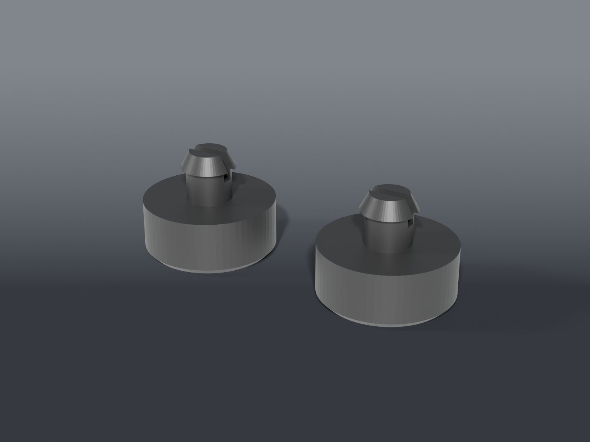

# Helping-hands plate feet

**Pegged TPU replacement feet** for a helping-hands base plate that arrived with a foot missing. The stock feet are glued over two holes in the plate. These snap through the holes instead: a barbed lip on the end of the peg pops out the far side of the steel and catches, so they stay put without glue.

## Parts

| Part | File | Size | Print |
|---|---|---|---|
| **Feet** | `helping_hands_feet.scad` | two feet, ⌀12 × 5 mm pad + ⌀4.1 × 3 mm peg + ⌀5.0 slit barb | ×1 plate — **TPU 95A**, pads down, no supports |
| Peg coupon | `coupons/peg_fit_coupon.scad` | pegs 3.8 / 3.9 / 4.0 / 4.1 | print first if your holes differ, ~1.3 g TPU |
| Lip coupon | `coupons/lip_fit_coupon.scad` | lips 4.4 / 4.6 / 4.8 | print first if your plate is thicker or thinner, ~2 g TPU |

## Sized from the plate

- **Hole:** 3.83 mm, calipered.
- **Peg:** 4.1 mm. On the coupon, the 4.1 peg pressed into the 3.83 hole best. It's 3 mm long, just past the steel, which is a little under 3 mm thick.
- **Lip:** a press fit alone fell out (v1.0.0), so the peg now ends in a barb. It tapers to ⌀3.4 so it finds the hole, then steps out to ⌀5.0 behind the plate. A slit across it lets the two halves fold in on the way through. The 4.8 lip on the coupon held, and 5.0 is one step firmer.
- **Foot:** 5 mm tall with a ⌀12 pad, with a small chamfer on the bottom edge so it doesn't curl or catch.
- **Two feet,** one per hole.

## Recommended print settings

| Setting | Value |
|---|---|
| Material | TPU 95A |
| Layer height | 0.2 mm |
| Walls | 3 |
| Infill | 100% — solid feet don't squash unevenly |
| Supports | None |
