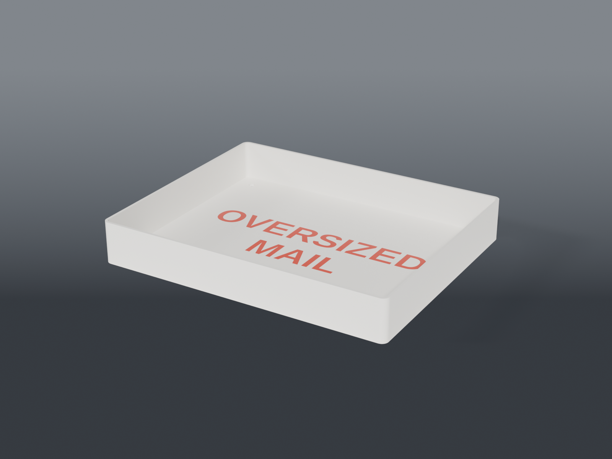

# Oversized mail tray

A **flat tray for oversized mail** that sits on the shelf below the mail slot, with **OVERSIZED MAIL** across its floor in a second colour. The carrier sees where the big envelopes go, and stops stuffing them through the slot.

## Parts

| Part | File | Size | Print |
|---|---|---|---|
| **Tray** | `mail_holder.scad` | 265 × 215 × 38 mm (1.5 in) | ×1 — floor down, no supports |
| **Letters** | `mail_holder_inlay.scad` | fills the 0.8 mm label pocket in the floor | with the tray, second colour |

**Two colours:** load both STLs at the same origin, then give the tray one filament and the letters another. The letters fill a 0.8 mm pocket in the floor's top face, flush, so the colour change is only the top few layers of the floor. Print the tray alone for a one-colour engraved label.

## Sizes

The footprint is the largest rectangle that fits the U1's 270 × 270 mm bed with room for a brim. Mail lies flat. A 9 × 12 inch envelope, 229 × 305 mm, overhangs the long side a little, as in any tray.

- **Walls:** 2.4 mm. **Floor:** 2.4 mm, which leaves 1.6 under the label.
- **Drain holes:** four, 6 mm, in the corners clear of the lettering, since an outside mail slot lets rain in.

## Checked

- One watertight body.
- Passes the slicing check: every layer has support under it.
- The letters fill their pocket exactly and sit flush with the floor.

## Recommended print settings

| Setting | Value |
|---|---|
| Material | PETG — it sits outside |
| Layer height | 0.2 mm |
| Walls | 3 |
| Infill | 15% |
| Supports | None |
